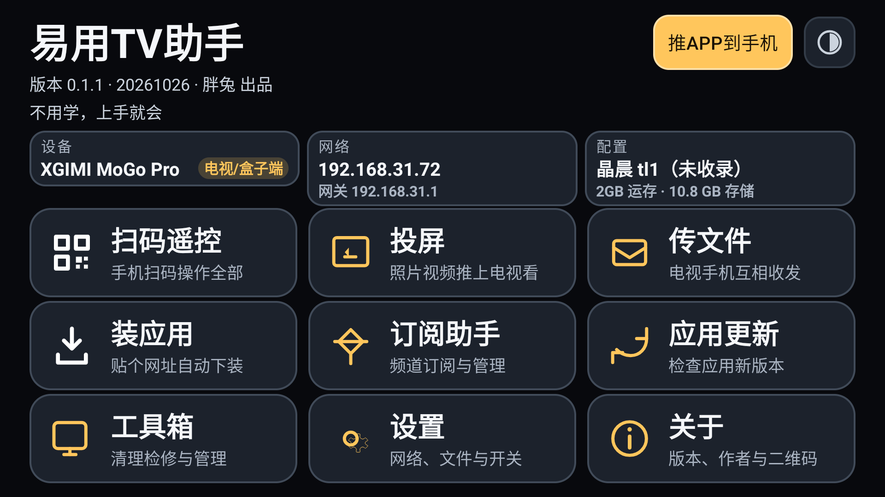
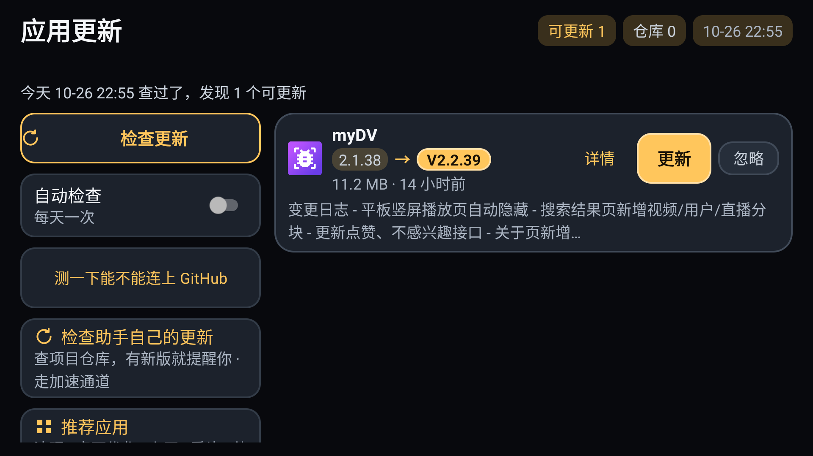
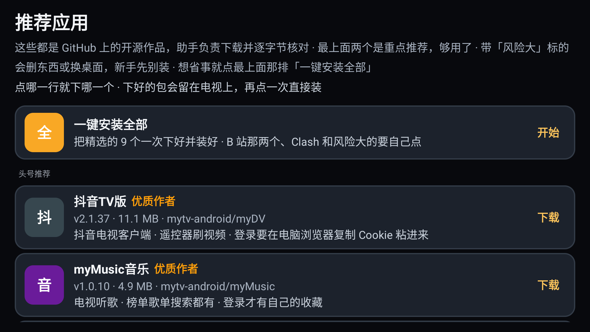
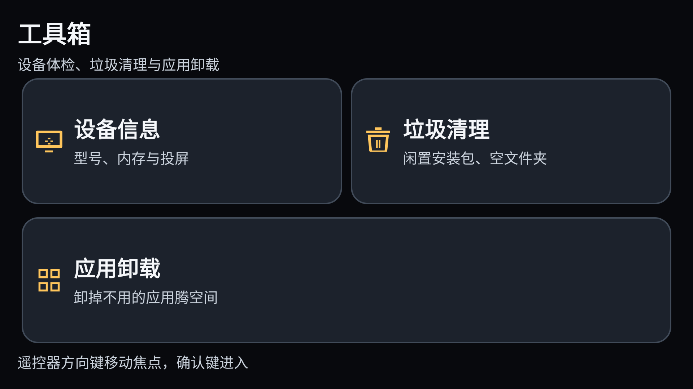
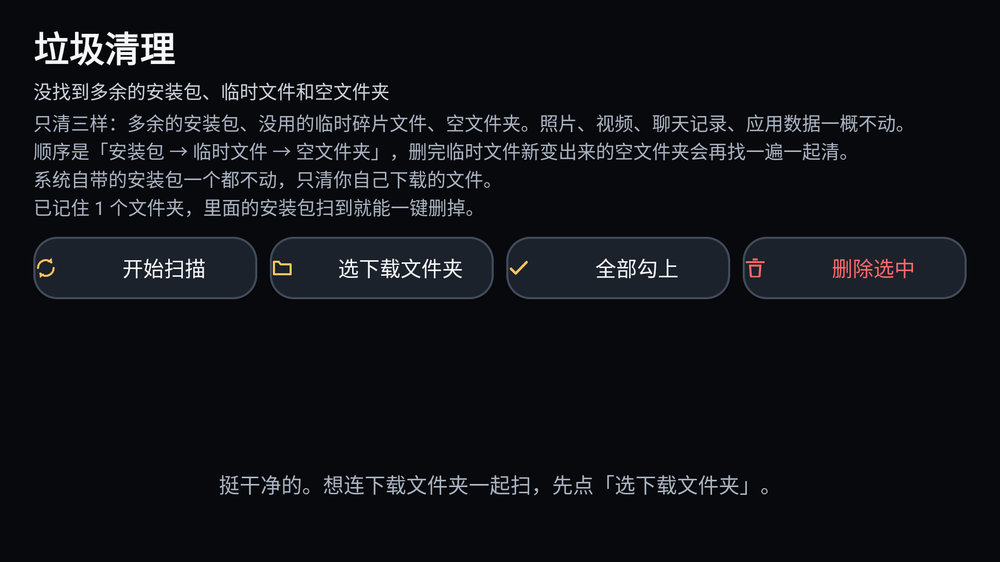

# 易用TV助手

## 为什么做

我们这一代人，很多东西都是自己摸索学会的。可现在的电视和盒子越做越花，看个电视先过会员验证，再挨一轮广告，遥控器上几十个按钮，老人根本找不到北。

家里老人常卡在这几件事上：字太小、按钮藏得深；手机里的照片想放到电视上看，得先学一遍投屏；传个文件只能插 U 盘；给电视装个应用，电视连浏览器都没有，还得把网址抄到手机上再传过去。这些事在别的软件里都是分开做的，有的还得先注册账号。

我就想把这些事摆在一页上，字放大，遥控器按一按就能用。不注册、不弹广告、不偷偷上传，不联网的功能照样能用。说到底就是让不擅长折腾电子产品的人，自己也能把电视用明白——这是我做它唯一的目的。

顺带也想证明一件事：普通人用 AI，也能手搓出自己真正想要的东西。

## 干什么

九个模块一页看完：扫码遥控、投屏、传文件、装应用、订阅推送、应用更新、工具箱、设置、关于。

一个包通吃安卓 5.0 以上的电视、盒子和手机，32/64 位都行，装完自己认设备。

## 下载

短链 <https://clck.ru/3WbUJx>　GitHub <https://github.com/pangtugg/easytv-partner>

## 更新记录

- **v0.1.2**：应用更新模块修复了部分机型下载后装不上的问题；推荐页与提示文案优化
- **v0.1.1**：应用更新模块重做，推荐入口更显眼；版面与遥控器焦点导航优化，并修正若干已知问题

## 截图

真机拍的，IP 与型号打了码。

| | |
|---|---|
|  |  |
| 主界面 | 应用更新 |
|  |  |
| 应用推荐 | 工具箱 |
|  | |
| 清理安装包 | |

## 推荐应用

应用更新里收了 16 个开源项目，一键装。这些都是第三方客户端，不是各平台官方应用。下载后按项目发布的大小和 SHA-256 逐项校验，再核对包名、版本和签名，对不上就删包换线路，不会直接装。

| 分组 | 应用 | 项目 | 作者 | 版本 | 状态 | 干什么 |
|---|---|---|---|---|---|
| 头号推荐 | 抖音TV版 | [mytv-android/myDV](https://github.com/mytv-android/myDV) | @mytv-android | 2.1.37 | 维护中 | 抖音电视端，登录要电脑复制 Cookie |
| 头号推荐 | myMusic | [mytv-android/myMusic](https://github.com/mytv-android/myMusic) | @mytv-android | 1.0.10 | 维护中 | 电视听歌，榜单歌单搜索 |
| 头号推荐 | 火锅短剧 | [mytv-android/myHotpot](https://github.com/mytv-android/myHotpot) | @mytv-android | 1.0.12 | 维护中 | 短剧播放器，打开就是剧没广告 |
| 头号推荐 | mytv直播壳 | [mytv-android/mytv-android](https://github.com/mytv-android/mytv-android) | @mytv-android | 2.2.0.219 | 维护中 | 直播播放器，装完要自己填源才有台 |
| 头号推荐 | BV（B站TV） | [mytv-android/bv](https://github.com/mytv-android/bv) | @mytv-android | 1.0.0 | 维护中 | B 站电视端，测试版 · 装之前要自己确认一条承诺，也不在一键安装里 |
| 重点推荐 | 红果短剧 | [aston314/hongguo-tv-releases](https://github.com/aston314/hongguo-tv-releases) | @aston314 | 0.2.115 | 维护中 | **社区维护版，不是官方出的**，更新最勤，建议先用 |
| 重点推荐 | 静观TV | [wangshaojie/LibreTV-App](https://github.com/wangshaojie/LibreTV-App) | @wangshaojie | 2.0.8 | 维护中 | 界面简单，安卓 5.0+ |
| 重点推荐 | BT（B站TV） | [chinasoul/BT](https://github.com/chinasoul/BT) | @chinasoul | 0.9.41 | 维护中 | B 站电视端，安卓 5.1+ · 装之前要确认一条承诺，也不在一键安装里 |
| 电视工具 | Clash Meta | [MetaCubeX/ClashMetaForAndroid](https://github.com/MetaCubeX/ClashMetaForAndroid) | @MetaCubeX | 2.11.36 | 维护中 | 小猫咪订阅，懂的都懂 |
| 电视工具 | Fluffy | [mlm-games/Fluffy](https://github.com/mlm-games/Fluffy) | @mlm-games | 4.5.1 | 维护中 | 文件管理器，能装 APK |
| 看剧观影 | VSTV | [vesaaa/vstv](https://github.com/vesaaa/vstv) | @vesaaa | 2.7.12 | 维护中 | 央视卫视地方台直播，装完就有台 |
| 看剧观影 | 短剧之家 | [jackherex/duanjuzhijia-down-tv](https://github.com/jackherex/duanjuzhijia-down-tv) | @jackherex | 3.0.22 | 维护中 | 红果短剧 TV 版 |
| 备用 | 影视仓 | [j4Uq/TVBoxOSC](https://github.com/j4Uq/TVBoxOSC) | @j4Uq | 20260914 | 更新放缓 | 空壳，要自己填配置 |
| 备用 | Clean Your TV | [udhaykumarbala/cleanyourtv-app](https://github.com/udhaykumarbala/cleanyourtv-app) | @udhaykumarbala | 0.3.4 | 维护中 | 删应用和缓存，风险大 |
| 备用 | 电视桌面优化 | [Ansub/tv-detox](https://github.com/Ansub/tv-detox) | @Ansub | 1.5.3 | 维护中 | 换默认桌面 · 装完还要照项目页跑一条 ADB 命令才生效 |
| 备用 | 抖音TV轻量版 | [markwaveio/douyin-tv-onn](https://github.com/markwaveio/douyin-tv-onn) | @markwaveio | 1.0.12 | 维护中 | 免登录，备选 |

哪位作者不想被收录，或者想改名改描述，说一声马上撤。

## 致谢

只借鉴思路，没抄代码：Clean Your TV 的清理做法、tv-detox 的桌面做减法、Clash Meta 的订阅导入、红果与抖音TV 社区的遥控交互、BT 的电视端播放。

## 反馈与授权

抖音 8700251，或 [Issues](https://github.com/pangtugg/easytv-partner/issues)。

[Apache 2.0](LICENSE)，另加两条：只供学习研究，禁商用；二次分发须署名「易用TV助手 / 胖兔 / 抖音 8700251」。
